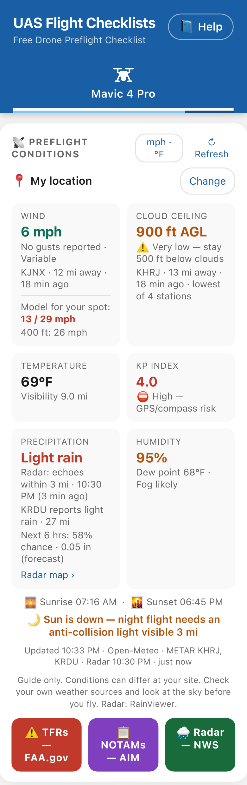
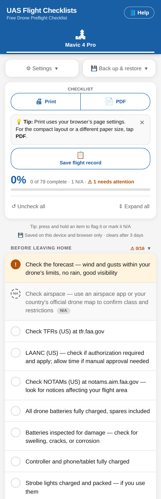
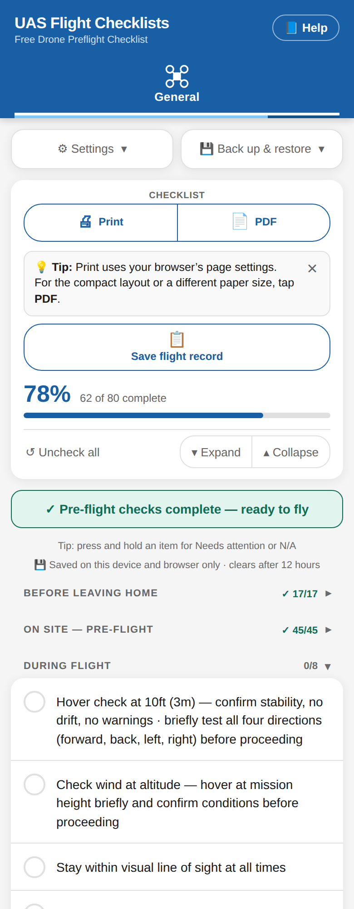
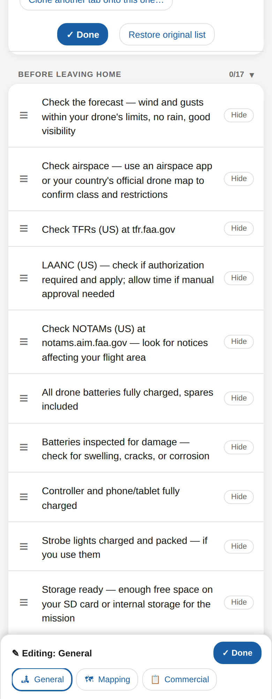
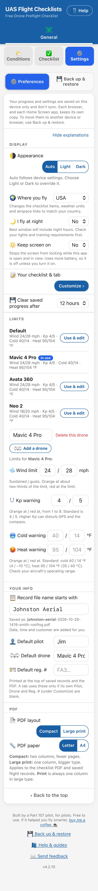
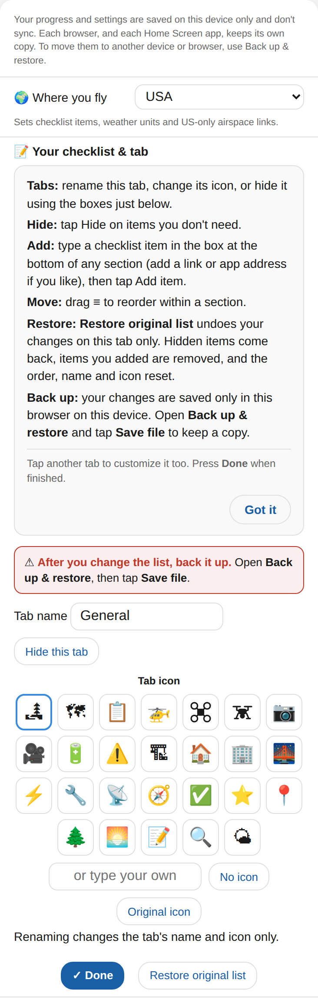
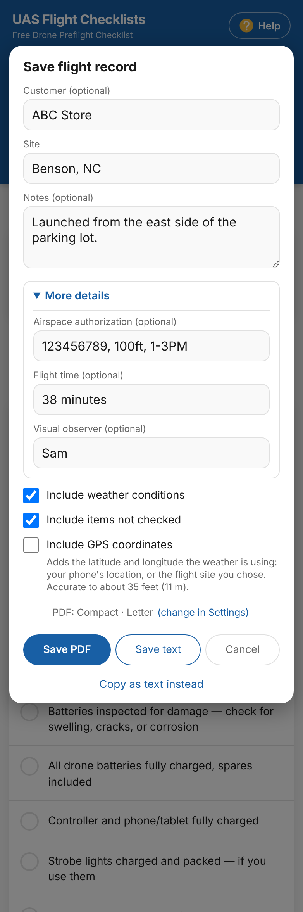
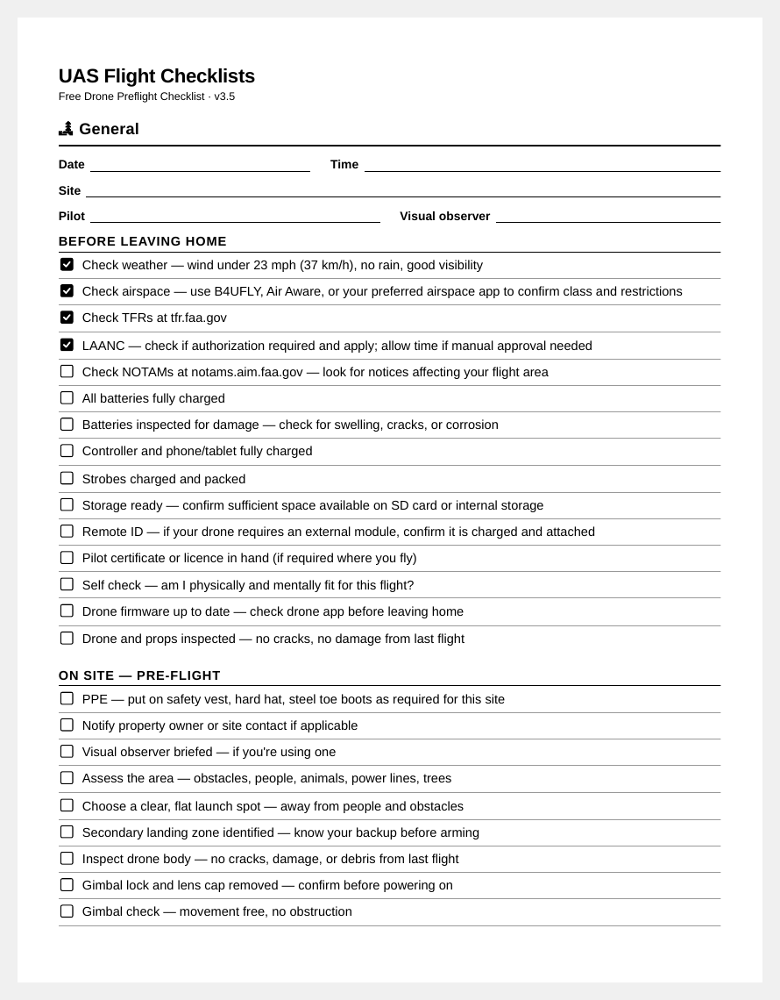
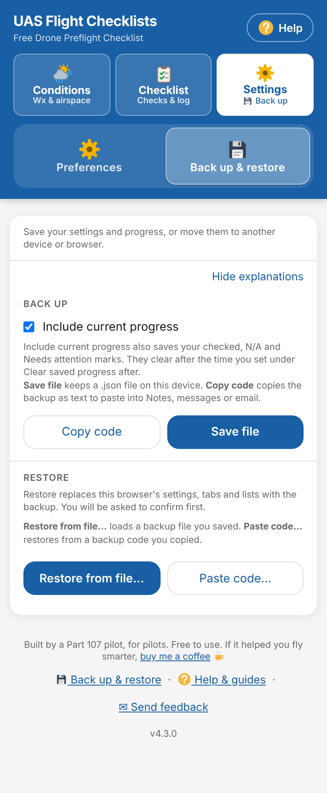
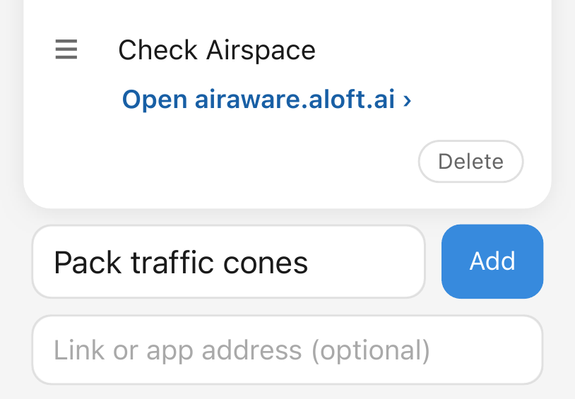

# UAS Flight Checklists

A free, mobile-friendly drone preflight checklist web app with live weather conditions built in. It works for recreational and commercial pilots in any country — hide the items that don't apply to you, add your own, put things in the order you fly them, and back it all up. No app to download, no subscription required — just open it in any browser and fly.

**Use it now:** [checklist.johnstonaerial.com](https://checklist.johnstonaerial.com)

📘 **New here?** Start with the [How-to guides](HOW-TO.md). You can also open them in the app with the **📘 Help** button at the top of the page, or the **Help & guides** link at the bottom of any tab.

☕ **Free to use.** If it helps you, you can [buy me a coffee](https://buymeacoffee.com/JohnstonAerial).

---

## Screenshots

<table>
  <tr>
    <td align="center" width="50%"><picture><source media="(prefers-color-scheme: dark)" srcset="screenshots/08-conditions-dark.png"></picture><br><sub><b>Live conditions</b></sub></td>
    <td align="center" width="50%"><picture><source media="(prefers-color-scheme: dark)" srcset="screenshots/01-checklist-dark.png"></picture><br><sub><b>Checklist</b></sub></td>
  </tr>
  <tr>
    <td align="center" width="50%"><picture><source media="(prefers-color-scheme: dark)" srcset="screenshots/05-ready-to-fly-dark.png"></picture><br><sub><b>&quot;Ready to fly&quot; banner</b></sub></td>
    <td align="center" width="50%"><picture><source media="(prefers-color-scheme: dark)" srcset="screenshots/04-reorder-dark.png"></picture><br><sub><b>Customize: drag, hide, add</b></sub></td>
  </tr>
  <tr>
    <td align="center" width="50%"><picture><source media="(prefers-color-scheme: dark)" srcset="screenshots/02-settings-dark.png"></picture><br><sub><b>Settings</b></sub></td>
    <td align="center" width="50%"><picture><source media="(prefers-color-scheme: dark)" srcset="screenshots/03-customize-dark.png"></picture><br><sub><b>Rename tabs, pick an icon</b></sub></td>
  </tr>
  <tr>
    <td align="center" width="50%"><picture><source media="(prefers-color-scheme: dark)" srcset="screenshots/06-save-record-dark.png"></picture><br><sub><b>Save a flight record</b></sub></td>
    <td align="center" width="50%"><br><sub><b>Print it for a pencil</b></sub></td>
  </tr>
  <tr>
    <td align="center" width="50%"><picture><source media="(prefers-color-scheme: dark)" srcset="screenshots/09-backup-restore-dark.png"></picture><br><sub><b>Back up &amp; restore</b></sub></td>
    <td align="center" width="50%"><picture><source media="(prefers-color-scheme: dark)" srcset="screenshots/10-add-item-link-dark.png"></picture><br><sub><b>Add an item, with or without a link</b></sub></td>
  </tr>
</table>

### What a saved flight record looks like

**Save flight record** makes a plain text file (or a PDF with real check boxes) of your preflight: who, where, the weather you saw, and every item you checked. Nothing is uploaded; it is made on your device. Here is a shortened example (the real one lists every item):

<details>
<summary><b>Show an example record</b></summary>

```
FLIGHT RECORD
=============
Sat, Oct 10, 2026 at 2:15 PM

Customer: Smith Roofing
Site: 123 Main St, Anytown
Checklist: Mavic 4 Pro
Pilot: Jane Smith
Drone: Mavic 4 Pro · Reg FA12345678

CONDITIONS
Wind: 8 mph (Gusts 14 mph · From NW; KXYZ · 6 mi away · observed 2:00 PM;
      Model for your spot: 9 / 17 mph; 400 ft: 16 mph)
Cloud Ceiling: 4,500 ft AGL
Temperature: 72°F (Visibility 10+ SM · KXYZ)
Precipitation: None (Radar: no echoes within 30 mi · 2:10 PM)
KP Index: 2.0
Humidity: 48% (Dew point 51°F)
Sunrise 07:16 AM · Sunset 06:45 PM
Golden hour 07:04 AM – 07:53 AM · 06:14 PM – 07:04 PM
Weather as of 2:12 PM · Open-Meteo · METAR KXYZ · Radar 2:10 PM

CHECKLIST — 56 OF 72 COMPLETE

Before leaving home
  [x] Check the forecast — wind and gusts within your drone's limits, no
      rain, good visibility
  [x] Check airspace — use an airspace app or your country's official drone
      map to confirm class and restrictions
  [x] All drone batteries fully charged, spares included
  ...

On site — pre-flight
  [x] Assess the area — obstacles, people, animals, power lines, trees,
      antennas, structures
  [x] Choose a safe takeoff and landing zone — level, clear overhead, away
      from people and obstacles
  ...

During flight
  [ ] Hover check at 10ft (3m) — confirm stability, no drift, no warnings
  ...

UAS Flight Checklists v3.7.12 · checklist.johnstonaerial.com
```

</details>

Items you flagged are listed as **NEEDS ATTENTION**, items you hid are left out, and the **Pilot**, **Drone** and **Reg. #** lines come from the tab's own Customize boxes, or from the defaults in **⚙ Settings** when those are blank. Anything you leave blank is left out of the record.

---

## What's new in v3.9.4

- **A shorter Settings panel** — **⚙ Settings** is grouped into **Display**, **Limits**, **Your info** and **PDF**. Drop-down boxes are only as wide as their text and sit on the right, and the settings take roughly a third less room on a phone.
- **Show or hide the explanations** — the grey explanation text under the settings has a **Hide explanations** link at the top. They are showing the first time you open the app. If you hide them, the app remembers on that device, and the choice is saved with **Back up & restore**. The line that says your settings are saved on this device only always stays.
- **Explanations for Back up & restore** — the same **Hide explanations** link now covers **Back up & restore**, which explains what **Include current progress** saves (your checked, N/A and Needs attention marks), what **Save file**, **Copy code**, **Restore from file…** and **Paste code…** do, and that a restore asks you to confirm first. It only mentions **Share…** on devices that show it.
- **Night note only when it matters** — the lights and training reminder under **I fly at night** always shows when night flying is on, and is an ordinary explanation (hidden with the others) when it is off. The setting now reads **No / Yes** so it fits on a phone.
- **Steady text size on iPhone** — turning the phone sideways no longer enlarges small text.
- **Small fixes on iPhone** — **Appearance** and **PDF layout** no longer overlap or get cut off, and the **Default reg. #** box no longer cuts off its hint.

---

## What's new in v4.2.3

- **"St", "St." and "Ste" places are found** — searching **St Paul Minnesota**, **St. Louis** or **Ste Genevieve** now finds the city. The place database spells these out as "Saint" and "Sainte", so the search looks up both spellings and shows the combined results, with your state or country first.
- **The ⚙ gears step aside once you add a drone** — when you have at least one drone, the gears on the **Wind**, **Temperature** and **KP Index** tiles are hidden. The blue drone pill's **⚙ Edit drones & limits** line takes you to the same place. Without a drone, the gears stay.

---

## What's new in v4.2.2

- **FAA UAS Facility Map, for the whole area** — the old **FAA grid map** button is now **🗺 FAA UAS Facility Map**, the FAA's own name. Its line now looks at every grid square within 3 miles of your place, not one square, and shows the spread: for example **0–400 ft nearby · LAANC**. It turns amber when some nearby squares are 0 ft (FAA approval needed there), and stays green when every square is above 0. If every nearby square matches you get one number, such as **400 ft · LAANC**, and where the FAA has no grid within 3 miles it says **No grid nearby**. Tap the button to open the FAA's map for the exact square.
- **Change how long your progress is kept, from the checklist** — the note under the progress card now ends **clears after 12 hours · change**. Tap **change** to open **Preferences** at **Clear saved progress after**; a **← Back to Checklist** bar returns you to the same spot.

---

## What's new in v4.2.1

- **Preferences | Back up & restore** — the top of the **⚙ Settings** tab is now a two-part switch, so you no longer open "Settings" inside "Settings". **⚙ Preferences** holds your display, limits, drones and info settings; **💾 Back up & restore** holds Back up and Restore. One half is always showing. The bar at the bottom now says **▴ Back to the top**.
- **Back up & restore in the footer of every tab** — the link at the bottom of **Conditions**, **Checklist** and **Settings** opens **Back up & restore** straight away. From Conditions or Checklist, a **← Back** bar at the top returns you to where you were.
- **Fix** — on **Default** in **Settings → Limits**, the drone name box and **Delete this drone** no longer show (there is nothing to rename or delete on Default).

---

## What's new in v4.2.0

- **Drones, each with their own limits** — add a drone in **⚙ Settings → Limits** (**＋ Add a drone**), name it, and set its own **wind**, **Kp** and **cold/heat** limits. A new drone starts as a copy of the limits you see, and your current limits stay as **Default**, so nothing changes until you add one. Once you have a drone, a blue pill under the place name on **Conditions** shows which drone's limits are in use, for example **Mini 4 Pro · wind 5 / 10 mph**. Tap it to switch: the Wind, Temperature and KP tiles, the Best window, the 24-hour strip and the no-flyable-window banner all follow the drone you pick. Drones are not tied to checklist tabs, so you can fly the same Mapping tab with a different drone on a different day. The drone list is included in **Back up & restore**.
- **The ⚙ gear opens the drone you're using** — the gear on the Wind, Temperature and KP tiles takes you to the limits for the selected drone, with the **← Back to Conditions** bar to return.

---

## What's new in v4.1.3

- **Gear on the Wind, Temperature and KP tiles** — a small ⚙ in the corner of those three tiles on **Conditions** opens **Settings** right at **Limits**, where your wind, Kp and cold/heat limits live. A blue **← Back to Conditions** bar at the top takes you straight back to where you were. The bar only shows when you arrive from a gear, and it disappears if you switch tabs yourself.

---

## What's new in v4.1.2

- **Official drone maps for 13 more countries** — the button under the weather now follows the place you look up and opens that country's official drone map or airspace page: **Austria** (Dronespace), **Switzerland** (FOCA drone map), **Italy** (D-Flight), **Spain** (ENAIRE), **Denmark** (dronezoner, via droneregler.dk), **Sweden** (LFV), **Norway** (Avinor), **Finland** (Traficom), **Poland** (DroneRadar), **Czech Republic** (DroneMap), **the Netherlands** (GoDrone), **Germany** (dipul) and **Ireland** (IAA). The FAA buttons are hidden in those countries, since they don't apply there. Some of these sites open in the local language.
- **Search understands a country** — type the town with its country, such as **Munich, Germany**, **Berlin Germany** or **Dublin Ireland**, and the results are limited to that country. Before, adding a country name found nothing.

---

## What's new in v4.1.1

- **Customize is on the Checklist tab** — a small **✎ Customize** button sits beside the percentage at the top of the checklist. It opens the same Customize screen as before, and **⚙ Settings → Customize** still works too.
- **Print, PDF and Save flight record moved to the bottom** — they are now in a card after the last section, just above the footer. Tap **↓ Print, PDF and Save flight record are at the bottom** under the progress card to jump straight there. The first time you open the app after this change, a blue **Moved** notice says the same, with a **Jump there** link. Close it with the **×** and it stays closed on that device. The choice is saved with **Back up & restore**. New visitors never see it.
- **One footer on every tab** — **buy me a coffee**, **Help & guides**, **Send feedback** and the version number now show at the bottom of **Conditions**, **Checklist** and **Settings**, not only the checklist.

---

## What's new in v4.1.0

- **Three tabs: Conditions, Checklist, Settings** — the app now opens on **🌤 Conditions**, the preflight weather card. **✅ Checklist** is one tap away, and **⚙ Settings** holds **Settings** and **Back up & restore**. The General, Mapping and Commercial tabs show on the Checklist and Settings tabs. The app remembers the tab you used last on that device. A red dot on **⚙ Settings** means a backup is due. Nothing you saved changes: your tabs, customized lists, progress and settings are the same as before, and **Customize** from Settings takes you to the checklist.
- **Saved places drop down from the search box** — under **Change**, tap the search box to see your saved places, and type to narrow them. It now remembers your last **10** places (it was 5).
- **The guide-only reminder moved to the top** — "Guide only. Check your own weather sources and the sky before you fly." now sits at the top of the weather card. The bottom line keeps just the radar credit.

---

## What's new in v4.0.14

- **The wind reminder moved to the top** — the note that obstructions and terrain can make it windier where you fly now sits at the top of the weather card, under the place name, instead of between the tiles. On a calm day it stays quiet gray. When wind needs attention (the airport or model wind is at caution level or higher, or a nearby station is windier) it turns amber and bold with a ⚠️.

---

## What's new in v4.0.13

- **TFR count on the button** — the **⚠️ TFRs — FAA.gov** button now shows how many TFRs the FAA lists for your state and nationwide, for example **NC: 3 · US: 12**. It is a count only and does not say whether one is near you, so the button still opens the FAA's list. (This uses the small Cloudflare Worker already used for weather. If you run your own copy, update `uas-metar-worker.js`; without it the count just doesn't appear.)
- **NOTAMs: nearby airport codes** — the FAA's NOTAM search opens with an empty **Location** box. The **📋 NOTAMs — AIM** button now shows the nearest airport and copies its code when you tap it, ready to paste. Under the buttons a **Nearby** row lists up to three airports with their distances. Tap one to switch to it, or tap **All 3** to copy all three comma-separated and search them together.
- **HOW-TO** — new tips for using the FAA's TFR page on a phone (turn it sideways, then use the search by state box) and for the NOTAM steps.

---

## What's new in v4.0.12

- **FAA grid map button** — the **Facility map — FAA** button is now **🗺 FAA grid map**. It opens the FAA's UAS Facility Map already centered on the place you chose, so there is no pop-up to accept and nothing to search for. The button also shows what the FAA grid says at that spot, such as **400 ft · LAANC**, **0 ft · FAA approval** or **No grid here**. It is a guide only, so still check LAANC or your airspace app before you fly. USA only, like the TFR and NOTAM buttons.

---

## What's new in v4.0.11

- **Buttons for your country** — the buttons under the weather now follow the place you look up. Countries with their own official drone resource get a button: **Australia** (CASA's verified drone safety apps), **Argentina** (ANAC rules and registration), **France** (the DGAC open-category page), **Belgium** (the Droneguide map), **the UK** (the NATS restriction zones map) and **Canada** (the NRC drone site selection tool), plus 13 European countries added in v4.1.2 (see below). In those countries the FAA buttons are hidden, since they don't apply.
- **Another country?** With **Outside USA** chosen, or a place from search in a country we don't have yet, you get **🌍 Find your aviation authority** (a list of national authorities) and a line asking you to tell us which country to add.
- **SkyVector always top left** — the airspace chart button stays in the top-left corner whatever the country, with the other buttons beside and below it.

---

## What's new in v4.0.10

- **Airspace chart outside the USA** — the **🛩 Airspace chart — SkyVector** button now stays when you choose **Outside USA** under **Where you fly**, because SkyVector has aviation charts for many countries. The USA-only buttons (**Facility map**, **TFRs**, **NOTAMs**) are still hidden. SkyVector is a chart for crewed aircraft: its TFR overlay is US only and it doesn't know your country's drone rules, so keep using your own aviation authority's rules and drone airspace app.

---

## What's new in v4.0.9

- **Better radar link** — in the USA, **Radar map ›** in the Precipitation tile now opens the National Weather Service radar, centred on your spot. Outside the USA it still opens RainViewer. The separate **Radar — NWS** button below the tiles is gone, since the tile link does the same job.
- **Even buttons** — the four buttons under the weather (USA only) are now a tidy two-by-two grid: **Facility map** and **Airspace chart** on top, **TFRs** and **NOTAMs** below.

---

## What's new in v4.0.8

- **Keep screen on** — a new setting in **⚙ Settings**. Turn it on and the screen will not lock while the app is open and in view. It is off by default (it uses more battery), is included in Back up and restore, and shows a note if your phone or browser can't do it.
- **Elevation and density altitude** — the Temperature tile now shows the elevation of your spot and an estimated density altitude (how thin the air acts, from temperature, humidity and pressure). It turns bold when the air is much thinner than the elevation alone, which can mean less lift and shorter battery life.
- **Cloud tile model line** — the Cloud Ceiling tile adds "Model for your spot" with the forecast cloud cover and low cloud, so it lines up with the Wind tile.
- **Tidier tiles** — the note about obstructions and terrain now sits once on its own line under the Wind and Cloud Ceiling tiles.

---

## What's new in v4.0.7

- **Quieter location label** — the place name on the forecast strip no longer has a pin and now uses the same grey as the strip's title, so it reads as a reminder of where the forecast is for and not something you can tap.

---

## What's new in v4.0.6

- **Your location on the forecast strip** — the title of the Next 24 hours / Next 10 days strip now shows where the forecast is for (your place name, or **My location**), to the right of the **24 hours | 10 days** switch. On a phone you no longer have to scroll to the top to check which place you are looking at. A long name wraps to a second line.

---

## What's new in v4.0.5

- **Next 24 hours** — the hourly strip under the weather tiles now shows the next 24 hours instead of 12, in every view (Wind, Aloft, Temp, Visibility, Clouds and Rain). The switch beside the view chip now reads **24 hours | 10 days**, and your saved choice still carries over. The Best window box and its look-ahead lines still look 12 hours ahead.
- **One airport per line** — the **Also reporting**, **Lower nearby** and **Windier nearby** lists now put each airport on its own line (code, value and distance), so a name never splits across lines on a narrow phone.
- **Cleaner Wind and Cloud Ceiling tiles** — the thin divider lines inside both tiles are gone, which saves a little height and reads more calmly.
- **Updated Live conditions screenshot** — the README picture now shows the current Wind and Cloud Ceiling tiles and the 24-hour strip.

---

## What's new in v4.0.4

- **Fixed: weather tiles cut off on narrow phones** — on some phones (or with large text), a long list in the Wind tile could push the Cloud Ceiling tile off the right edge of the screen. Both tiles now always fit, and the lists wrap cleanly between airports instead of inside a number or a distance.
- **Windier nearby is quieter** — the line now appears only when the other airport's wind is outside the green band of your wind limits (orange or red) and is notably windier, so a calm morning no longer shows a "windier" airport at 5 mph.

---

## What's new in v4.0.3

- **Also reporting, on the Cloud Ceiling tile** — when none of the other airports within 30 miles has a lower ceiling than the nearest one, the tile now lists up to two of them (nearest first) with their ceilings, so you can see whether the airports around you agree. If one is lower, the existing **Lower nearby** line shows instead.
- **Simpler wind details** — the list under **more** on the Wind tile no longer repeats the ground wind (it is already shown as **Model for your spot**). It now shows the wind at about 260 ft and 400 ft.

---

## What's new in v4.0.2

- **Windier nearby** — the Wind tile shows the nearest airport's observed wind first. If another airport within 30 miles has a recent report that is at least 5 mph windier, or in a worse colour band against your limits, the tile now adds a **Windier nearby** line with that airport, its wind and its distance (up to two). It only appears when it is useful; on calm or even days nothing changes.
- **A reminder under the wind** — a short note at the bottom of the Wind tile: obstructions and terrain can make it windier where you fly. The numbers are a baseline, and the call is still yours.

---

## What's new in v4.0.1

- **Airspace chart button** — a new full-width button under the weather links, **🛩 Airspace chart — SkyVector**, opens a free aviation chart centered on your spot with TFRs drawn on it. It works on phones and tablets. It is a pilot's chart, not drone-specific, and it can miss some TFRs, so the FAA **TFRs** button is still the official list.
- **Clearer key under the hourly strip** — the dimmed hours are now labelled **dimmed = night** (the hours before sunrise and after sunset), instead of "dimmed = after sunset".

---

## What's new in v4.0

- **10-day outlook** — the **Next 12 hours** strip now has a **12 hours | 10 days** switch beside the view chip. In the 10-day view each chip is one day, showing the daytime peak wind (with gusts beneath) coloured by your wind limits. The other views work the same way: **Aloft** shows the peak wind at 400 ft, **Temp** the high with the low beneath, **Visibility** the lowest, **Clouds** the daytime average, and **Rain** the highest chance with the amount. Swipe sideways to see all ten days.
- **Tap a day for a summary** — tapping a day changes only the grey line above the strip, for example **Wed 21 · Best 3p–6p · 8–11 mph · rain 0%**. Tap it again, or switch back to 12 hours, to clear it. The window box and tiles still describe the next 12 hours.
- **Days 6 to 10 are a rough guide** — those days are drawn lighter and their summary starts with **Rough guide**. Check again closer to the day.
- **Your view is remembered** — the 12 hours / 10 days choice and the Wind / Aloft / Temp / Visibility / Clouds / Rain view now stay as you left them, and they are included in **Back up** and **Restore**.
- **Two new checklist lines** — **SD card inserted and its cover closed — before powering on**, and **Arms unfolded and locked — and landing gear in place, if your drone has it**, on all three tabs.

---

## What's new in v3.9.12

- **The window box leads with the earliest window** — when there is more than one flyable stretch, the **Possible window** / **Best window** box now shows the earliest run of 2 hours or more. If a later run is longer, a short **Longer:** line mentions it.
- **Clearer wind wording** — the Wind tile says **Sustained speeds · gusts not forecast aloft**. In **Next 12 hours**, the Wind view says it is the ground wind, with a short caption and a key that reads **Sustained / gusts**, and the Aloft view reads **Wind at 400 ft · sustained only · mph**.
- **iPad PDF box** — after you tap **PDF** (or **Save PDF** in a flight record) on an iPad, the "Your PDF is ready" box now appears with **View** and **Share…**. **Share…** has **Save to Files**. On an iPhone or iPad, if the Share sheet can't open, the PDF opens in a new tab instead.
- **Tidier text on small screens** — clock times like 11:10 AM, "7 min ago" and the dots and slashes between items no longer split across two lines. Saved records and PDFs are not affected.
- **Clearer explanations in Settings** — the hints for **Wind**, **Kp**, **Cold** and **Heat**, and the **PDF layout** note, are reworded. The **PDF layout** note now says **Compact** is two columns with fewer pages, **Large print** is one column in bigger type, and **Print** is always one column in large type.

---

## What's new in v3.9.11

- **The night notice follows "I fly at night"** — when the sun is down, the notice at the bottom of the weather card used to look the same whether or not you fly at night. With **I fly at night** on in Settings it now reads a calm **Night flying on — anti-collision light visible 3 SM**; with it off, it stays the amber **Sun is down** warning. Outside the USA it says to check your local rules.
- **No double reminder** — when the **Possible window** or **Best window** box already says **Night hours included — anti-collision lights required**, the notice at the bottom steps aside so you only see it once.

---

## What's new in v3.9.10

- **View button for your PDF on computers** — after you tap **PDF** (or **Save PDF** in a flight record) on a computer, the "Your PDF is ready" box now has **View** next to **Share…** and **Download**. **View** opens the PDF in a new browser tab so you can read it and print it from there. If your browser blocks the new tab, use **Download**. Phones and tablets work as before.
- **Same buttons for everyone** — the small print tip now sits below the **Print**, **PDF** and **Save flight record** buttons, so the buttons look the same whether or not the tip is showing.

---

## What's new in v3.9.9

- **A tidier Wind and Cloud ceiling tile** — the wind arrow now says what it means (**↓ from N** shows the wind coming from the north), and the opened **more** view under Wind drops the repeated figures: one short note, the Ground / 260 ft / 400 ft table, and the **Wind builds with height** box when it applies. The Cloud ceiling tile lists the airport's cloud layers on one line.
- **Cloud trend moved** — whether the sky is easing, building or steady now leads the caption of the **Clouds** view on the Next 12 hours strip (for example **Easing: 100% now → 8% by 5a**).

---

## What's new in v3.9.8

- **Six views for the Next 12 hours strip** — tap the small chip on the strip title (**Wind ▾**) to switch between **Wind** (sustained wind with the gust underneath), **Aloft** (wind at 400 ft, or 120 m), **Temp**, **Visibility** (with a **fog** flag when the temperature is close to the dew point), **Clouds** and **Rain** (chance and amount). Colours follow your wind and temperature limits, and the line under the title says what each view shows. The strip always opens on Wind.

---

## What's new in v3.9.7.1

- **Change the wind unit right on the Wind tile** — the unit next to the wind number is now a small dropdown chip (**mph ▾**). Tap it to see wind in mph, km/h, m/s or knots, for a quick look or for good. The tile, the height rows, the **Next 12 hours** strip and the Best window all follow, and your choice is saved and backed up. The separate **Wind speed** row in Settings and the small hint are gone.

---

## What's new in v3.9.7

- **Imperial / Metric button fits on narrow phones** — the second line (for example **°F · mi · ft**) stays on one row instead of wrapping into three lines when the text is large or the screen is narrow.

---

## What's new in v3.9.6

- **Wind speed unit on the Wind tile** — tap the small unit chip (for example **mph ▾**) on the Wind tile to read wind in mph, km/h, m/s or knots. It starts as mph for USA and km/h for Outside USA, and stays what you choose.
- **Imperial / Metric button** — the button at the top of the weather panel now reads **Imperial** or **Metric** and switches temperature, distance and altitude. It leaves your wind unit alone.
- **Wind by height** — a **more** link on the Wind tile shows wind at ground level, 260 ft and 400 ft, with a note when it gets stronger higher up.
- **Next 12 hours** — a sideways-swiping strip under the tiles shows wind and gusts hour by hour, coloured by your wind limits, with rain chance. Since v4.0 it can also show the next 10 days, and since v4.0.5 the hourly view covers 24 hours.
- **Cloud ceiling details** — the tile lists the airport's cloud layers (the easing or building trend moved to the Clouds view of the hourly strip in v3.9.9).
- **Print** — closing the print dialog returns you to where you were on the checklist.

---

## What's new in v3.9.5

- **Clearer wording in Settings** — **Appearance** now reads "Auto follows device settings. Choose Light or Dark to override it." **Where you fly** says it changes the checklist items, weather units and airspace links to match your country. The **I fly at night** note says Best window will include night hours, and to check your lights and training requirements first.
- **"This browser" instead of "this device"** — your settings, tabs and lists are kept by each browser (and each Home Screen app) separately, so the saved notes, the back-up reminder and the **Restore** warning now say **this browser**.
- **Back up & restore wording by device** — AirDrop and **Save to Files** are only mentioned on iPhone, iPad and Mac. On Android, Windows and other devices it says to save the backup where you like or send it by email or a messaging app.

---

## What's new in v3.9.3

- **Fly at night, with lights** — a new **🌙 I fly at night** setting under **⚙ Settings** (next to **Where you fly**). It is **No** by default. Set it to **Yes, with lights** and the **Best window** also counts night hours, with a reminder that anti-collision lights are required. Night flying needs anti-collision lights and current night training or a waiver, so it is your call to turn it on. The setting is saved with **Back up & restore**.
- **A clearer message at night** — with the setting off, the red box now says **No flyable daylight window in the next 12 hrs**, so after dark it no longer reads as if every hour is unflyable.

---

## What's new in v3.9.2

- **Best window is color-coded** — the box on the weather card now tells you at a glance. **Green** is a **Best window**: two or more hours in a row when wind, gusts, rain and visibility are all fine. **Orange** is a **Possible window**: there is no green stretch, but there are two or more dry hours with good visibility when the wind is above your orange point and still under your limits. It says **Fly with caution** and shows the wind and gusts to expect. **Red** is **No flyable window in the next 12 hrs**: wind at or over your limits, rain or storms, or low cloud or visibility, with the reason underneath.
- **Best window follows the airport's visibility** — for the current hour, the Best window now uses the same visibility as the **Visibility** tile: the nearest airport report when there is one, otherwise the forecast. A low forecast no longer holds back **Now** when the airport reports 3 SM or more, and a foggy airport report holds it back in every country, not only the US.
- **A clearer message when Save file can't open the share sheet** — in **Back up & restore**, if your browser won't open the share sheet, the message now says so, names the error, and tells you to tap **Save file** again to choose where to save it.

---

## What's new in v3.9.1

- **Best window no longer ignores fog** — the **Best window** line was built from the hourly forecast alone, so it could say **Now – 9 AM** while the airport reported a 100 ft cloud ceiling and 1.5 SM visibility. Now, when the airport reports a ceiling or visibility below minimums, **Now** doesn't count. A window that starts later says **Low cloud or visibility reported now**, and if no hour qualifies, **No calm window** says so too. The forecast still can't tell when fog will lift, so check the airport report before you go.

---

## What's new in v3.9

- **One tab per drone** — each tab can now have its own **Pilot**, **Drone** and **Reg. #**. In **Customize**, type them in the boxes under **For records and PDFs saved from this tab**. They print on that tab's saved flight records and checklist PDF. A box you leave empty uses the default from **⚙ Settings**, so you only fill in what's different. The three Settings boxes are now labeled **Default pilot**, **Default drone** and **Default reg. #**.
- **Clone another tab onto this one** — in **Customize**, **Clone another tab onto this one…** makes the tab you're on an exact, editable copy of another tab, including its Drone, Reg. # and Pilot. Handy if you fly several drones and want the same list on each tab. You pick the tab to copy from, and a confirmation names both tabs before anything is replaced. **Undo** works until you leave or reload the page, and **Restore original list** brings the tab's own list back.
- **Copy to… for items you added** — each item you added now has a **Copy to…** button. It copies the item, and its link, to another tab. If that tab already has an item with the same name in the section, it says so instead of making a duplicate.
- **Six more drone icons, in color** — pick from drawn icons for a Mavic-style drone, FPV, whoop, wing, hex and Inspire-style drone. A color row under the icons recolors the drawn ones. **Restore original list** clears the color.
- **A tab icon picker that folds away** — Customize shows the current icon with a **Change ›** button. The icon grid and colors open only when you want them.
- **A bottom bar that names the tab** — while you customize, the bar at the bottom of the screen says which tab you're editing and follows the name if you rename it. Tab chips on the bar jump to another tab, so you don't scroll up to switch.
- **A shorter Customize screen** — while you customize, **Appearance**, **Where you fly**, the limits, the record file name and the PDF settings are hidden, so your checklist sits much closer to the top. They come back when you press **Done**.
- **Hiding a tab no longer jumps to the top** — hide a tab and you land on the next tab's Customize, not at the top of the page.
- **A clearer back-up reminder** — the line in Customize now reads **After you make changes, back them up.** Your customizing lives only on this device and browser, so a backup is how you keep it.

---

## What's new in v3.8.14

- **Links show the useful part** — an item whose link opens an email, a call, a text or FaceTime now shows the address or number, for example **info@JohnstonAerial.com ›** or **+19195550100 ›**, instead of just **Email ›** or **Call ›**. A Shortcuts link shows the shortcut's own name, for example **Open Air Aware ›**. Anything after a `?` in the link (a subject, a message) still works when you tap, it just isn't shown. Items you already made update on their own.
- **Edit your own items** — in **Customize**, each item you added has a blue **Edit** button and a red **Delete** button on a row under it. **Edit** changes the text and the link in place, and keeps the item's place and checkmark.
- **Links you've used before** — the **Link or app address** box suggests the links you've already saved, so you can tap one instead of typing it again.
- **A clearer Customize button** — in **⚙ Settings**, **Customize ›** is now a solid blue button that's easy to find.
- **Expand and Collapse** — the progress card has an **Expand | Collapse** pair instead of one button that changed its name. **Collapse** folds every section in one tap for a clean screen; **Expand** opens them all. The one that has nothing to do is dimmed.
- **A tidier Restore row** — in **Back up & restore**, **Restore from file…** and **Paste code…** sit side by side. **Paste code…** opens the box for a backup code, and the box and any message close again when you close it. **Save file** is a solid blue button, like **Restore from file…**.
- **Honest Save file message** — in browsers that start a plain download, such as Safari, the message now says **Backup started. If your browser asks, choose where to save it.** It no longer claims the file went to Downloads. The backup file name uses your own date.
- **Orange for caution** — the caution color is now an orange-leaning amber in light mode (it was a gold that was hard to tell from yellow), and the notes in **⚙ Settings** say **orange at / red at**. Dark mode is unchanged.
- **More room in the Limits settings** — extra space between the Wind, Kp, Cold and Heat rows and their notes.
- **A longer wait for your location** — the app now waits up to 30 seconds to find you, since a computer can be slower at it than a phone.

---

## What's new in v3.8.13

- **Light or dark, your choice** — **⚙ Settings** has a new **Appearance** row: **Auto** follows your device (as before), or choose **Light** or **Dark**. Handy for Light in bright sun while your phone is in dark mode. Your choice is included in Back up & restore.
- **Temperature now has warning colors** — the Temperature card is green in the normal range and turns amber and then red when it gets cold or hot. The standard points are cold amber at 40 °F (4 °C) and red at 14 °F (−10 °C), heat amber at 95 °F (35 °C) and red at 104 °F (40 °C). Set your own in **⚙ Settings** (**Cold warning** and **Heat warning**), based on your aircraft's operating range. They are included in Back up & restore.
- **Clearer colors** — a truer red in both light and dark mode, and a gold amber in light mode, so caution and stop are easy to tell apart at a glance.

---

## What's new in v3.8.12

- **Easier to read in dark mode** — the green used for good conditions, the "Ready to fly" banner, section counts and the Back up message is now lighter in dark mode, so it no longer fades into the background.
- **Back up & restore messages stand out** — "Backup complete" (or an error) now appears in a bordered box instead of a thin line of small text.

---

## What's new in v3.8.11

- **Visit counting can be turned off on your own devices** — this page uses Cloudflare Web Analytics to count visits. If you run the checklist, you can keep your own visits out of the numbers: open the page once with `?notrack` on the end of the address (for example `checklist.johnstonaerial.com/?notrack`). That browser then stops sending visits, until you open it once with `?track`. Nothing else about the app changes.

---

## What's new in v3.8.10

- **Back-up reminders, so you never lose your customizing** — your changes are saved only in that browser on that device, so the app now reminds you to back up. While you customize, a red line under **How to customize** says **After you change the list, back it up**. When you press **Done**, or change a setting such as **Pilot**, **Drone**, **Reg. #**, your wind or Kp limits or your PDF choices, a red banner appears under the **Settings** and **Back up & restore** buttons with a **Back up now** button. It stays until you back up or dismiss it. The how-to card also has a new **Back up** line, and the **How-to guides** now explain it first.
- **The add button says Add item** — the box for a new checklist item is full width, the optional link box sits under it, and the button on the right reads **Add item**.
- **A clear Close bar** — the small ▴ arrow at the bottom of **Settings** and **Back up & restore** is now a full-width bar, **▴ Close settings** or **▴ Close back up & restore**. While either is open, everything below it is hidden so the bar is the end of the page. Customize still shows your checklist.

---

## What's new in v3.8.9

- **Visibility is easier to read** — in the Temperature tile, visibility now has its own **Visibility** label and a larger value, such as **10+ SM · KJNX**. It is **green at 3 SM or more** and **red below 3 SM**, with **⛔ Below 3 SM minimum** underneath. In US units it now reads **SM** (statute miles), the way you scan for it. Metric still shows km, and distances to airports still show mi.
- **FAA UAS Facility Maps button** — a fourth button on the weather card, **🗺 Facility map — FAA**, opens the FAA's UAS Facility Maps (the **Visualize it** map) for LAANC grid altitudes. The buttons now sit in a 2×2 grid, and like the TFR, NOTAM and radar buttons it is hidden outside the USA.
- **Golden hour fits your screen** — on a tablet or computer it stays on one line. On a narrow phone it splits into **✨ Golden hour**, the morning window and the evening window, so a time range never breaks in the middle.
- **Tiles in a better order** — **Temperature** sits beside **Precipitation** (both tall) and **KP Index** beside **Humidity** (both short), so there is less blank space on the card. The saved record lists them in the same order.
- **The press-and-hold tip matches the menu** — it now reads **Tip: press and hold an item for Needs attention or N/A**, the same words as the menu, and it wraps evenly on a narrow screen.

---

## What's new in v3.8.8

- **Reset is now "Uncheck all"** — the button at the bottom of the progress card cleared only your ticks, flags and N/A marks, but the word "Reset" sounded like it wiped more. **↺ Uncheck all** says what it does, and the confirmation spells it out: "This clears the ticks, flags and N/A marks on 3 items. Items you hid or added stay as they are."
- **Restore original list tells you what it will change** — the confirmation now lists only what applies to that tab, with counts, for example "This brings back 2 hidden items, removes the 3 items you added and resets the tab name and icon. Other tabs and your ticks are not changed." It only ever affects the tab you're editing.
- **A Restore line in "How to customize"** — the card at the top of **Customize** now explains **Restore original list** alongside Tabs, Hide, Add and Move.

---

## What's new in v3.8.7

- **Customize is easier to find and follow** — in **⚙ Settings**, the row now reads **📝 Your checklist & tab** with a **Customize** button, so it's clear that Customize covers the tab itself (its name, icon and Hide) as well as the items on it. While you customize, the bar at the bottom says **Editing this checklist and tab**, and the page scrolls to the controls for you.
- **A "How to customize" card at the top** — the instructions (**Tabs**, **Hide**, **Add**, **Move**) now sit at the top of that block, above the **Tab name** box, instead of further down the page. Tap **Got it** and the card shrinks to a one-line **ⓘ How to customize ›** that you can tap to bring it back. **Back up & restore** remembers that you tapped **Got it**.
- **Adding your own item is clearer** — the box now reads **\* Checklist item, e.g. Check airspace**. If you tap **Add** with nothing typed, the box turns red and asks for the checklist item. Tapping **Done** saves a filled-in box, and clears one that is only half filled in, so nothing is left behind.
- **Add a link to your own items** — when you add an item, the optional **Link or app address** box turns it into a shortcut. Great for a **Check airspace** item that opens your airspace app. It isn't only websites; see the table below.

| Type this in the link box | The item shows | What it does |
|---|---|---|
| `airaware.aloft.ai` or `https://airaware.aloft.ai` | **Open airaware.aloft.ai ›** | Opens the website. On an iPhone, a site with its own app may open in that app. |
| `mailto:someone@example.com` | **someone@example.com ›** | Starts an email to that address. You can add a subject and message, for example `mailto:someone@example.com?subject=Job%20done&body=Job%20complete`. |
| `tel:+19105551212` | **+19105551212 ›** | Starts a phone call. |
| `sms:+19105551212` | **+19105551212 ›** | Starts a text message. On an iPhone, add `&body=On%20my%20way` to fill in the message. |
| `facetime:someone@example.com` | **someone@example.com ›** | Starts a FaceTime call. |
| `dji://…` or any `name://…` | **Open name app ›** | Opens that app, if it's installed and publishes an address like this. |
| `shortcuts://run-shortcut?name=Open%20Air%20Aware` | **Open Air Aware ›** | Runs an iPhone or iPad Shortcut by name, and shows that name. See the tip below. |

Spaces aren't allowed in a link: write `%20` for a space, `%0A` for a new line and `%26` for an `&` inside text. Unsafe types such as `javascript:` and `file:` are refused. If the box turns red, the address wasn't accepted. The link sits under the item's text, so ticking the item works as before.

**iPhone tip: open an app that has no web address.** Some apps can't be opened with a link. Make a Shortcut that opens the app, then link to the Shortcut:

1. In the **Shortcuts** app, tap **+** and add the **Open App** action. Choose the app, such as Air Aware.
2. Name the shortcut as an action, for example **Open Air Aware**.
3. In the checklist's **Link or app address** box, type `shortcuts://run-shortcut?name=Open%20Air%20Aware`. The name must match the shortcut's name exactly, with `%20` for each space.

The item then shows **Open Air Aware ›**, the shortcut's own name. Tapping it runs the shortcut, which opens your app. The Shortcuts app may flash on screen first, and iOS may ask you to allow it the first time. This works on iPhone and iPad only.

- **Fix: the Customize button fits on small or zoomed phone screens** — it is no longer cut off at the right edge.

---

## What's new in v3.8.6

- **More of what airports report, worldwide** — the weather card now reads the full standard set of airport weather codes. A **funnel cloud** or **tornado/waterspout** report turns the Precipitation card red with the airport and distance; **squalls** show in amber. **Sandstorms and duststorms** show on the Humidity card, and blowing or drifting dust, sand and snow, dust whirls and spray are named in words. **Freezing rain and drizzle** keep the word "freezing", showers and thunderstorms with rain or hail read clearly, and several conditions at once (for example "rain and snow") are all shown. Anything near the airport but not at it says "in the vicinity". Unknown codes are skipped.
- **PDF on a computer: Download or Share** — on a Mac or other computer with a mouse, **PDF** (the checklist and the flight record) opens a small box with **Download** and **Share…**. **Download** saves to your Downloads folder, where you can open it and print or move it. The Mac share sheet has no Print or Save to Files, so Download comes first. Phones and tablets work as before and go straight to the share sheet.
- **Fix: Download really downloads** — in the box that appears when the share sheet doesn't open, **Download** no longer tries the share sheet first.
- **A tip on Print** — a small tip under **Print | PDF** explains that Print uses your browser's page settings and that **PDF** gives you the compact layout or a different paper size. Tap **×** to dismiss it. **Back up & restore** remembers that you dismissed it.

---

## What's new in v3.8.5

- **Airport temperature and humidity** — **Temperature**, dew point and **Humidity** now come from the nearest airport report within 30 miles when it is no more than 75 minutes old, with the airport code and distance shown. The forecast model is the fallback, labeled as such.
- **Fog, mist and haze from the airport** — when the nearest airport report says fog, mist, haze, smoke, dust, sand or volcanic ash, the **Humidity** card says so in words with the airport and distance. Fog is shown in bold amber (red only when visibility is also under 3 miles); the others are a plain note. It is also written into your saved flight record.
- **Set your own Kp warning** — **⚙ Settings** has a new **Kp warning** row for where the Kp card turns amber and red. The standard points are now amber at 4 (active) and red at 5 (storm); leave a box empty to use them. It is saved with your other settings and included in Back up & restore.
- **Kp with decimals** — the Kp card shows the current estimate, for example 2.3, instead of a whole number.
- **Fix: precipitation words** — airport reports that list rain and another condition together (for example "-RA BR") are now read correctly.

---

## What's new in v3.8.4

- **Mark an item N/A** — press and hold any item and a small menu appears: **Needs attention** or **N/A for this flight**. An N/A item is greyed with an **N/A** tag and doesn't count for or against your progress (for example "12 of 78 complete · 2 N/A"). A section where everything is N/A counts as done. Tap an N/A item to put it back. It's remembered like your ticks and cleared by **Reset**. If you'd rather never see an item, **Hide** it in customize instead.
- **N/A in your records** — **Print**, **PDF** and the **flight record** show N/A items greyed with "(N/A)" and a dash in the box, so the paper copy says why an item wasn't ticked.
- **Ceiling from the nearest station** — the weather card now takes the cloud ceiling from the nearest airport report within 30 miles. If a farther station is lower, it shows as a plain note, "Lower nearby", and doesn't color the card.
- **Visibility from the nearest airport report** — when a report no older than 75 minutes is available, **Visibility** shows that reading with the airport code (for example "10+ mi · KJNX"), and the red **Below 3 mi minimum** warning applies to what was actually reported. The weather forecast is the fallback, labeled as the forecast model. Lower readings at farther stations appear as a "Lower nearby" note.

---

## What's new in v3.8.3

- **A shorter PDF: Compact layout** — the checklist **PDF** and the **flight record PDF** now run the items in two columns at a slightly smaller size, so a full list takes about half the pages (the General checklist is 2 pages instead of 4 on Letter). If you want bigger text, choose **Large print** and you get the one-column layout you had before. Pick it in **⚙ Settings**, under **PDF layout**. Hidden items stay out of the PDF and your own items are in it, as before.
- **Letter or A4 paper** — **⚙ Settings**, under **PDF paper**. The first time, the app picks Letter for English and North American browsers and A4 everywhere else, and then remembers what you choose. The flight record PDF uses the same paper size.
- **A reminder of where to change it** — after you save or share a PDF, the message says which layout and paper it used, with **Change in Settings**. The **Save flight record** box shows the same choice above its buttons, and tapping **(change in Settings)** takes you straight to it. What you had typed in the box is kept.
- **In your backup** — your PDF layout and paper choices are carried by **Back up & restore** like your other settings.

---

## What's new in v3.8.2

- **A best window for flying** — when the next 12 hours of daylight are not all good, the weather card shows the longest stretch (2 hours or more) when wind, gusts, rain and visibility are all fine, for example **Best window 10 AM – 7 PM · Wind up to 5 mph, gusts up to 8 mph**. It uses your own **Wind limit** in **⚙ Settings**: an hour counts as calm when sustained wind and gusts are below the amber point, about two-thirds of your limits. It also needs rain chance under 30%, no storms in the forecast and visibility of at least 3 mi (5 km). If the rain is clearing, it says so (**Rain clears by 1 PM**). When there is no such stretch you see **No calm window in the next 12 hrs** and the reason. When every daylight hour is fine, the line stays out of the way. Like the rest of the card it is a forecast guide, so check the sky and your own sources.
- **Tab names and custom items no longer get lost with several windows open** — if the checklist was open in more than one browser tab or window, an older one could overwrite a tab name, icon or hidden tab (or your own items) that you had just changed in another. Now, when those settings change in another window, this one reloads to pick them up: right away if it is in the background, otherwise when you come back to it. Your progress and any unsaved record draft are kept.

---

## What's new in v3.8.1

New checklist items, on top of v3.8. Each is a plain item you can hide in **Customize**, and your saved progress is not affected.

- **Lens and sensors clear** (every tab, after **Gimbal check**) — no fog, dew or smudges, and let the drone adjust if it came from a hot car or a house.
- **Temperature** (every tab, after **Battery installed and latched**) — stay within your drone's operating range. Cold: keep batteries warm until launch and expect a shorter flight. Heat: keep the drone and batteries out of the sun and a hot car.
- **Let batteries cool before charging** (every tab, in **Post-flight**, just before **Put batteries on charger when home**) — a hot battery should rest first.
- **Fly the upwind leg first** (General and Commercial, after **Flight plan**) — so the drone returns with the wind behind it.
- **Video shutter** (General, after **Set camera**) — if you shoot video, about twice your frame rate (1/60 at 30 fps), and fix exposure with the ND filter, not the shutter.
- **Compass calibration now also covers a prompt from the app or controller** — it reads "calibrate if the app or controller asks for it, in a new location, or near large metal structures". If you had it checked, hidden or placed in your own order, that carries over.
- **Other calibrations** (every tab, right after the compass item) — IMU, gimbal, vision sensors and controller sticks: calibrate when the app warns, or after a crash or hard landing.

---

## What's new in v3.8

- **Golden hour on the weather card** — under the sunrise and sunset times you now see the two golden-hour windows for your flight site, for example **Golden hour 07:05 AM – 07:54 AM · 06:13 PM – 07:03 PM**. It is worked out on your device from where the sun is (between 4° below and 6° above the horizon), so it needs no extra connection, works in any country, follows your flight site's time zone and uses your device's 12 or 24 hour clock. Expect it to be within a few minutes of other sources. It is left out when the sun never reaches that range, for example in the polar winter.
- **A link to AfterGlow** — under it, **Will the sky color up? AfterGlow sky forecast ›** opens [AfterGlow](https://afterglow.johnstonaerial.com), the free sunrise and sunset sky forecast, at the same place you are checking here. If you have not used AfterGlow before it remembers that place; if you already have a place saved there, it uses this one for that visit and leaves your saved place alone.
- **Golden hour on your saved record** — the saved flight record (text and PDF) carries a **Golden hour** line right after the sunrise and sunset line.

---

## What's new in v3.7.13

- **The night-flight reminder is on your saved record** — when the sun is down as you save a flight record, the record (text and PDF) now carries the same line the weather card shows, right under the sunrise and sunset times: in the USA "Sun is down — night flight needs an anti-collision light visible 3 mi", elsewhere "Sun is down — check your local rules for night flying". In daylight nothing is added.
- **Start and stop screen recording** — two new checklist items, on every tab. **Start screen recording on your controller or phone — if you record your flights** comes near the end of **On site — pre-flight**, just before the final "No drone app warnings or errors" check. **Stop screen recording — before you power off the controller** comes in **Post-flight**, right after the safe landing. Hide them in **Customize** if you don't record. Your saved progress is not affected.
- **Save file is a plain download on computers** — on a desktop or laptop, **Save file** now saves the file and **Share…** is the only button that opens the share sheet (before, both opened the same pop-up on a Mac). Phones and tablets still open the Share sheet from **Save file**. In Chrome and Edge the Save dialog now remembers the folder you picked last time.
- **A clearer Back up & restore card** — **Restore from file…** is now the first, wide button in **Restore**, then "Or paste a backup code" with the box and **Restore from code** underneath it. On a computer the Back up row reads **Copy code | Share… | Save file**, so **Save file** sits right above **Restore from file…**.

---

## What's new in v3.7.12

- **Pilot, Drone and Reg. # in Settings** — three new boxes in **⚙ Settings**, under **Record file name starts with**. Type your name, your drone and its registration number once and the app remembers them on that device. They are printed near the top of your saved flight records (text and PDF) as, for example, "Pilot: Jane Smith" and "Drone: Mavic 4 Pro · Reg FA12345678", and they fill in the Pilot, Drone and Registration lines on the checklist **PDF**. Leave a box empty and nothing is printed for it. They are included in **Back up & restore**, so a backup per drone is an easy way to switch between aircraft.
- **Save flight record no longer loses what you typed** — if you close the Share sheet without choosing anything, the Save record box stays open with everything still filled in. If you tap outside the box or reload the page, your customer, site and notes are kept for 12 hours and come back the next time you open it. They are cleared once you save, copy, or tap **Cancel**.
- **Clearer messages after sharing** — after you choose where to send a record from the Share sheet, the message now says **Record shared** or **PDF shared**. When a file goes to your Downloads folder it still says it was saved to your downloads.
- **A small ▴ arrow closes Settings and Back up & restore** — at the bottom corner of each open section, so you don't have to scroll back to the top to close it.
- **The wind card now shows what the airport is actually reporting** — when a weather station within 30 miles has reported in the last 75 minutes, the card leads with that measured wind: sustained speed, gusts (or "No gusts reported") and direction, with the station, how far away it is and how old the report is. Below it, a **Model for your spot** line shows the forecast model's wind for exactly where you are, then the wind at 400 ft. Each number is colored by its own reading against your wind limit. If no station is close enough or recent enough, the card shows the model wind as before. The flight record includes both readings.
- **Checked items look right while you customize** — an item you had ticked off used to look crossed out and hidden when you opened Customize. Ticked items now look normal there, and only items you've actually hidden are crossed out and faded.
- **Share… on computers** — in **Back up & restore** on a desktop or laptop (Safari, Chrome, Edge and other browsers that can share), a new **Share…** button opens your computer's share sheet, so you can AirDrop, email or message your backup code. To restore, paste the code into **Restore from code**. Phones and tablets already share from **Save file**, so they don't show it. Firefox on a computer can't share from a web page, so use **Copy code** or **Save file** there.
- **Save file asks where to put it** — in Chrome and Edge on a computer, **Save file** now opens a Save dialog so you choose the folder and the name. In Safari on a Mac, turn on "Ask for each download" in Safari's settings if you'd like to pick the folder.
- **Tidier Back up box** — the "Include current progress" checkbox now sits right beside its label instead of at the far edge.

---

## What's new in v3.7.10

- **Clearer Back up & restore messages** — a small wording update, nothing else changed. The restore box now says **Paste a backup code here**. After **Copy code** the message reads "Code copied. Paste it into Back up & restore in another browser or app, or keep it somewhere safe," which also covers moving between Safari and your Home Screen app. After **Save file** it reads "Backup complete. Restore it any time with Restore from file…," so it works on the same device later as well as on a new one.

---

## What's new in v3.7.9

- **Customize is easier to follow** — the instructions now sit in a card right above the checklist, where you're working: **Hide** (tap Hide on items you don't need), **Add** (use "Add your own item" at the bottom of any section) and **Move** (drag ≡ to reorder within a section). While you customize, the progress card is hidden to give the list more room, and it comes back when you tap **Done**. The tab name, icon and **Hide this tab** controls stay in Settings, and they now use the full width of the screen, including on a narrow phone or with larger text.
- **Where you fly** — the setting that was called "Checklist for" now reads **Where you fly**, with a line under it saying what it changes: the checklist items, the weather units and the US-only airspace links.
- **Buttons first on the progress card** — **Print | PDF** and **Save flight record** are at the top of the card, then the percentage and bar, then **Reset** and **Expand all** at the bottom.
- **Flight record file names** — saved records are named `flight-record-…` (they were `preflight-record-…`), and the title inside the record now reads **Flight Record**. A new setting at the bottom of **⚙ Settings**, **Record file name starts with**, lets you put your own name at the front, for example `johnston-aerial`. The date, time and customer are still added for you. Leave it empty for `flight-record`. It's saved in **Back up & restore**.
- **A clearer saved note** — it now says **Saved on this device and browser only**, because Safari and a Home Screen app each keep their own copy.
- **Version at the bottom** — the header now shows just the name and tagline, and the version number sits under the links at the bottom of the page. **Help & guides** and **Send feedback** also stack cleanly on a narrow screen.

---

## What's new in v3.7.8

- **A tidier progress card** — the percentage and count sit on top with the bar under them, then the buttons: **Print | PDF** together on the left under a small **CHECKLIST** label, and **📋 Save flight record** on the right. **Reset** and **Expand all** moved to a quiet row at the bottom of the card, away from the top edge of the screen. On a narrow phone, or with larger text, the buttons stack and nothing overlaps.
- **Save record is now Save flight record** — the button, the pop-up title and the "Log the flight" item all use the same name. If you have ticked, flagged or customized that item, your progress carries over.
- **Save flight record pop-up** — **Save PDF**, **Save text** and **Cancel** are in one row. The button you used last is still the filled one.
- **Print and PDF show your ticks** — **Print** and **PDF** (it was Save checklist as PDF) make the checklist as it stands, with your checked and flagged items marked and blank lines for date, time, site, pilot and visual observer. Neither is a blank sheet.
- **A new footer line** — "Built by a Part 107 pilot, for pilots. Free to use. If it helped you fly smarter, buy me a coffee ☕"

---

## What's new in v3.7.7

- **Your own wind limit** — in **⚙ Settings**, set the sustained wind and gust limits your drone can handle. The wind card turns amber at about two-thirds of your limit and red at the limit, and gusts now count too. Leave the boxes empty for the standard limits (23 mph sustained, 25 mph gusts). The boxes follow your units (mph or km/h) and are saved in Back up & restore.
- **Settings and Back up & restore are two buttons** under the page header, each opening its own card, so the checklist starts higher on the page. **Settings** is one short list: Checklist for, Checklist items, Clear saved progress after, Wind limit and Kp warning, with the "saved on this device only" note at the top. **Back up & restore** has clear Back up and Restore halves.
- **Help, feedback and coffee at the bottom** — **📘 Help & guides** and **✉ Send feedback** now sit on one line at the bottom of each tab, under the coffee line. **Send feedback** opens an email to info@JohnstonAerial.com with your app version and device filled in, so you can add what works, what's missing or what's confusing.
- Small wording changes: the **✎ Customize list** button now reads **✎ Customize**, and **Outside the USA** now reads **Outside USA**.

---

## What's new in v3.7.6

- **Tidier Save record pop-up** — **Save as PDF** is one wide button, with **Save text** and **Cancel** side by side under it, so the labels no longer wrap on a phone. **Copy as text instead** moved below the buttons.

---

## What's new in v3.7.5

- **Save as PDF** — the **Save record** pop-up now has **Save as PDF** next to **Save text**. The PDF has the same details as the text record (customer, site, weather, every section with what was checked, flagged items, notes) with real check boxes and page numbers. The button you used last is the filled one, so it remembers your choice. PDF is the filled button until you pick text.
- **Save checklist as PDF** — a new button under **Print checklist** and **Save record**. It makes a clean, blank paper checklist for the open tab, with lines for date, time, site, pilot and visual observer, as a PDF you can save, share or print. Unlike **Print checklist**, it works in the iPhone and iPad Home Screen app too.

---

## What's new in v3.7.4

- **Bigger tabs with your own icons** — each tab now shows a larger icon above a larger name. In **Customize**, pick a different icon for the tab you're on from the presets (including two drone drawings), type any emoji you like, or choose no icon. **Original icon** puts it back. Icons are saved with your tab names, so a backup carries them.
- **Search by full state name** (since v3.7.3) — location search now understands "Ocala Florida" and "Ocala, Florida", not just "Ocala FL".

---

## What's new in v3.7.2

- **Fewer false radar warnings** — a single stray radar echo (birds, insects, dust) no longer triggers the precipitation warning. Radar now has to show a small cluster of echoes within about 3 miles. When radar is the only sign of wet weather, the card says **Radar echoes nearby** with a **No rain reported** note instead of "Precip. nearby", so it doesn't imply rain that nobody has reported.
- **Brand-neutral button item** — the pre-flight item about custom buttons now reads "Controller programmable buttons — confirm mapping for this flight", so it fits any controller. Your checked and hidden state carries over.

---

## What's new in v3.7

- **One wording and order on all three tabs** — every item was reviewed one by one. General, Mapping and Commercial now share the same wording and the same order wherever an item appears on more than one tab.
- **Clearer, shorter items** — for example the weather lines say "within your drone's limits" instead of fixed numbers, the airspace line points to an airspace app or your country's official drone map, and the battery line says to start back early enough to land with a reserve instead of quoting a percentage.
- **New or extended items** — Remote ID (at home and module attached on site), hourly insurance on General, firmware on the drone, controller and each battery, strobe lights, line of sight, max altitude and people entering the zone on every tab, power off and inspect after landing, notify and wrap up with your site contact, and a log line that points to **Save record**.
- **Accessories split from gear** — "Gear packed" and "Accessories packed" are separate lines, and the pilot certificate and registration line is worded for pilots outside the USA too.
- **(US) tags** — items that only apply in the USA (TFRs, LAANC, the TFR recheck) are marked "(US)" and hidden when you choose **Outside the USA**. The NOTAM line is reworded for other countries.
- **Upgrading is safe** — reworded items keep their checked, flagged, hidden and custom-order state. Two items were removed because they duplicated others: "Wait 60 seconds for GPS lock" (General) and "Import all images to backup drive" (Mapping).

---

## What's new in v3.6

- **Starts tidy** — the first time you open the checklist, only the first section of each tab is open and the rest are folded, so the long lists don't greet you all at once. Tap any header to open it. If you've used the checklist before, it keeps your layout.
- **Finished sections fold themselves** — when you check off the last item in a section, it folds and the next unfinished section opens. If you've flagged an item as needing attention, the section stays open until it's resolved. Reset puts everything back, and printing still shows every item.

---

## What's new in v3.5.8

- **Antennas out** — a new item before powering on, a reminder to deploy your controller's antennas.
- **Visit counter** — a privacy-focused counter, with no cookies and no personal information, so I can see how many people use the checklist.

---

## What's new in v3.5.7

- **External pressures check** — a new item at the start of **On site — pre-flight** on all three tabs: "feeling rushed or pushed to fly? Would you still fly without it?" It's the "E" in the FAA's PAVE risk check, and the one most often skipped.

---

## What's new in v3.5.6

- **Buy me a coffee button shows on more screens** — it now appears next to **📘 Help** on iPads held upright, phones turned sideways, and any screen where the page is zoomed in. It still stays hidden on a phone held upright, and when you print.

---

## What's new in v3.5.5

- **Buy me a coffee button on bigger screens** — on a computer, tablet or unfolded folding phone, a **☕ Buy me a coffee** button now sits next to **📘 Help** at the top of the page. It doesn't show on a phone, where space is tight, or when you print.

---

## What's new in v3.5.4

- **Buy me a coffee** — the checklist is free, and now there's a small way to say thanks: a **☕ Buy me a coffee** link in Settings & customize, and a quiet one-line note at the bottom of each tab. Neither shows when you print.

---

## What's new in v3.5.3

- **More checklist items** — a few things that are easy to forget:
  - **Gear packed** and **Battery installed and latched** on all three tabs
  - **Max distance** (next to Max altitude) and **Recheck TFRs** (on site) on all three tabs
  - **Bystanders warned** on General and Mapping
  - **Flight plan** on General and Commercial
  - On Mapping: **RTK FIX** before launch, and **Ground control points** for survey-accuracy jobs
- **Self check now spells out IMSAFE** — Illness, Medication, Stress, Alcohol, Fatigue, Eating. If you had that item checked, it shows unchecked once after you update.
- **Matching wording** — "Log flight time in your records" now reads the same on every tab

---

## What's new in v3.5.2

- **Help button** — a **📘 Help** button at the top right of the page opens these guides without opening Settings first

---

## What's new in v3.5.1

Small changes to **Save record**:

- **GPS coordinates are optional** — the record no longer includes your coordinates unless you tick **Include GPS coordinates**. The box is off by default
- **Site starts blank** — type an address or place name, or leave it empty. If you chose a flight site on the weather card, its name fills in
- **Copy as text instead** — a link in the Save record pop-up that copies the record to your clipboard as plain text, with no file. Handy when the Share sheet saves it as a file you didn't want
- **Clock times in the weather section** — the record shows "observed 02:51 PM" and "Weather as of 03:12 PM" instead of "21 min ago", so it still makes sense when you open it later. The wind arrow is left out of the record because it already says "From NE"
- **Back to the top** — after you save or copy a record, the page scrolls back to the top

---

## What's new in v3.5

Save a record of your preflight, and print the checklist:

- **Save record** — a new button on each tab. It makes a plain text file of the checklist as it stands: customer, site, date and time, the weather conditions (optional), every section with what was checked, and your notes. Items you flagged are listed as **NEEDS ATTENTION**. Items you hid are left out and items you added are included. On an iPhone or iPad it opens the Share sheet (Save to Files, AirDrop, Mail, Messages); on a computer it downloads the file. Nothing is uploaded: the record is made on your device
- **Optional details** — under **More details**: airspace authorization (for example a LAANC reference, altitude and times), flight time, and visual observer. Anything left blank is left out of the record
- **Items not checked** — choose whether the record lists the items you didn't check (shown as `[ ]`) or only what you completed
- **Print checklist** — prints the open tab: square tick boxes, black on white, every section open, about 3 pages, and blank lines at the top for date, time, site, pilot and visual observer. Use a pencil at the site. Printing isn't available in the iPhone **Home Screen app** (iOS doesn't allow it); open the page in Safari to print
- **Shorter progress card** — the percentage and bar sit on top and the four buttons (Print checklist, Save record, Reset, Collapse all) sit in two rows, so the checklist starts higher on the screen
- **Fix** — saving a backup file with **Save to Files** on an iPhone no longer also saves a stray small text file

---

## What's new in v3.2.3

A few more preflight checks, and a new look:

- **New checklist items** (General tab) — *Controller and phone/tablet fully charged*, *Visual observer briefed — if you're using one*, *Test photo or short clip — confirm it records and the exposure looks right*, and *Watch signal strength and satellite count for signs of interference*
- **GPS check merged** — satellite count and home point are now one item: *GPS satellite count and home point — confirm strong lock (10+ satellites) and that the home point is updated*
- **New app icon** — a dusk sky with a rising sun, a drone and a checklist. On iPhone, delete the Home Screen app and add it again to see it
- If you've customized your lists, the two reworded items (controller charged, GPS) show up as new items, so you may need to hide or re-tick them once. Your other settings and progress are unchanged

---

## What's new in v3.2.2

The weather card now tells you when your phone has no signal:

- **Offline note on resume** — if you leave the app, lose signal, and come back, the last readings stay on screen with **📴 No signal — weather isn't updating. Showing data from [time].** You no longer have to tap Refresh to find out
- **Instant message when opened offline** — with no signal at all, you see **📴 No signal — can't load the weather** straight away instead of a long "Loading…"
- **Refreshes itself when signal returns** — the note clears and the weather updates on its own
- A weak or flaky connection behaves as before (it retries once, then keeps your last readings with a "Couldn't refresh" note)

---

## What's new in v3.2.1

A small fix on the weather card (USA setting):

- **Low visibility is flagged** — visibility under 3 miles now shows in red with **⛔ Below 3 mi minimum**, so it no longer depends on reading the number
- **Humidity says why it's red** — when fog is likely *and* visibility is under 3 miles, the line reads *Fog likely, visibility under 3 mi*

---

## What's new in v3.2

Version 3.2 makes the checklist work in more places and for more people:

- **Works with no signal** — open it once with a connection and it opens again with none (for example at a remote site). The checklist, your own items and your settings all work offline; weather says so and refreshes when you're back online. When you do have a signal you always get the newest version
- **Max altitude line (USA)** — when the cloud ceiling is above 500 ft but below 900 ft, the Cloud Ceiling card adds **Max legal altitude about … ft AGL (500 ft below clouds)**, so you know how high you can actually go. A ceiling of **500 ft or lower is now red: Cannot fly**
- **Night notice** — after sunset or before sunrise the weather card reminds you what night flying needs (in the USA, an anti-collision light visible for 3 miles; elsewhere, check your local rules). It follows the clock, even if the weather hasn't refreshed, and it is printed on the saved flight record
- **Best window is smarter** — when it is raining now, it shows the *longest* dry stretch of at least 2 hours in the next 12 hours, not just the next dry hour
- **Humidity** — fog risk is amber; it turns red only when fog is likely and visibility is already under 3 miles
- **Far-away flight sites** — if your flight site is in a different time zone, rain, storm and sunrise/sunset times are marked **(site time)**
- **Clear messages when something fails** — weather, airport reports, KP index, place search and location lookups now time out after 12 seconds with plain wording ("Airport reports unavailable — check another source") instead of showing a misleading number
- **Easier to read and use** — screen-reader labels and announcements (checklist items, tabs and weather updates), keyboard control, larger touch targets, better text contrast, 16 px form fields so iPhones don't zoom in, a layout that fits very small phones, and pinch-to-zoom is no longer blocked
- **📘 Help & guides** link in ⚙ Settings, and a new [How-to guides](HOW-TO.md) page: make your own profiles (with a real timelapse example), use it with no signal, use it outside the USA, and check TFRs and NOTAMs

---

## What's new in v3.1

Version 3.1 makes the weather card much more useful on a rainy or low-cloud day:

- **Cloud ceiling from the lowest nearby station** — it checks every airport weather report within 30 miles and shows the lowest ceiling (with the station, distance and age), the cautious choice. A **Lowest cloud nearby** line helps with the cloud-clearance rule
- **Precipitation card** — combines live **radar** (RainViewer, free), **airport weather reports** and the forecast. Headlines include *Precip. nearby*, *Precip. likely*, the airport's own wording (for example *Light rain*), and *Rain possible* when only the forecast thinks so — with a note when radar doesn't see it
- **Look-ahead lines** — *Rain likely ~4 PM*, *Best window ~8 PM – 2 AM*, *No clear window next 12 hrs* and *Storms possible*, shown only when there is something to say
- **Humidity card** with dew point and a fog / lens-fogging warning
- **Radar — NWS button opens on your location**
- **Source footer** — lists where each reading came from (forecast, airport station, radar time)
- **Weak signal friendly** — if a refresh fails, the last good reading stays on screen with a short note, and the app retries once
- Guide only: always check your own weather sources and look at the sky before you fly

---

## What's new in v3.0

Version 3 is a major update built around making the checklist *yours*:

- **⚙ Settings & customize panel** — everything that configures the checklist now lives in one tidy, collapsible panel at the top of each tab: how long progress is kept, where you fly (USA or outside), Customize, tab names and icons, and backup
- **Reorder items** — in Customize mode, drag the **≡** handle to move any item up or down within its section
- **Back up & restore** — copy a code or save a file of your settings (and, optionally, your current progress), then restore it on another phone, tablet or browser — or on the same one after a reset
- **Two-stage banner** — a green banner tells you when your pre-flight checks are done (**ready to fly**) and again when the whole flight is finished (**flight complete**)
- **Floating Done bar** — while you customize, a bar stays pinned to the bottom of the screen with a **Done** button, so you never have to scroll back to finish
- **Tabs stay out of your way** — switch tabs while customizing and Settings stays open, so you can tidy several tabs in one pass
- **Cleaner layout** — the progress bar sits right above the checklist with **Reset** and **Collapse all / Expand all** beside it; **Expand all** appears as soon as any section is folded
- **Upgrading is safe** — saved progress, hidden and added items, region, units and fold state carry over from v2.x

---

## Features

- **3 mission-specific tabs** — General, Mapping, and Commercial (rename, change the icon of, or hide any of them)
- **Live Preflight Conditions panel** showing:
  - Wind speed, gusts, and direction arrow, plus wind at 400 ft
  - Cloud ceiling in feet AGL from nearby airport (METAR) reports
  - Temperature and visibility (from the nearest airport report when one is fresh)
  - Precipitation: live radar at your location, airport reports and the forecast, with a link to the radar map
  - Humidity and dew point, with a fog and lens-fogging warning and any fog, mist or haze the airport reports
  - KP Index (space weather / GPS interference risk)
  - Sunrise and sunset times, and the golden hour windows, with a link to the AfterGlow sky forecast for the same place
  - The best window of the next 12 daylight hours, worked out from your own Wind limit
- **Color-coded cards** — green means fine, orange means caution, red means serious. The wind card turns orange at about two-thirds of your wind limit and red at the limit (by default 23 mph sustained or 25 mph gusts; you can set your own in Settings). The cloud ceiling turns orange below 1,000 ft and red at 500 ft or lower (Cannot fly). Visibility is green at 3 statute miles (SM) or more and red below 3 SM. KP index turns orange at 4 and red at 5 unless you set your own in Settings. Temperature is orange at 40 °F or below and 95 °F or above, and red at 14 °F or below and 104 °F or above, unless you set your own in Settings. Fog risk is orange and turns red only when visibility is also under 3 miles. Precipitation is red when radar, an airport report or the forecast confirm it, and orange on radar echoes or a forecast alone
- **Night notice** — after sunset or before sunrise, the weather card reminds you what night flying needs (in the USA, an anti-collision light visible for 3 miles; elsewhere, check your local rules), and the reminder is printed on the saved flight record
- **Choose your flight site** — check weather for where you're going, not just where you are; recent sites are remembered on your device
- **One-tap buttons** for TFRs, NOTAMs, and NWS Radar (see [How-to guides](HOW-TO.md#check-tfrs-and-notams-before-you-fly-usa) for how to read them)
- **Progress tracker** — percentage complete per tab, with a **ready to fly** banner when your pre-flight sections are done and a **flight complete** banner when everything is
- **Works outside the USA** — the first time you open it, choose **USA** or **Outside USA**. Choosing outside the USA hides the items marked "(US)" (TFR and LAANC checks and the TFR recheck on site), rewords the NOTAM item so it isn't tied to a US website, hides the FAA buttons under the weather panel (SkyVector stays, and countries with their own drone resource get a button, such as Australia, Argentina, France, Belgium, the UK and Canada), and switches the weather to metric. Change it any time in **⚙ Settings**
- **Customize the list** — open **⚙ Settings** and tap **Customize** (in the **Your checklist & tab** row) to hide items that don't apply where you fly, add your own items to any section, change or delete the ones you added with **Edit** and **Delete**, and drag items into the order you prefer. Hidden items don't count toward progress, and checks follow an item when you move it. **Restore original list** puts the tab back to the defaults
- **Rename, re-icon or hide tabs** — in Customize mode, rename the tab you're on, give it a different icon (pick a drawn drone icon and color, type your own emoji, or choose none), set its own Pilot, Drone and Reg. #, clone another tab onto it, or hide it (at least one tab always stays), and bring hidden tabs back from any tab. Items you added can be copied to another tab with **Copy to…**. Renaming and changing the icon change only how the tab looks; use Hide and Add to change what's inside it
- **Back up & restore** — see below
- **Collapsible sections** — tap a section header to fold it up or open it, or use the **Expand | Collapse** buttons on the progress card. Finished sections fold themselves and the next unfinished one opens, and on your first visit only the first section of each tab is open. Each header shows its count (like 9/12), a ✓ when it's finished and an orange ⚠ if something in it needs attention, even when folded. Your fold state is remembered
- **Progress is saved on your device** — checks and flags survive a reload or an accidental app close, and expire so the next flight starts clean. The default is 12 hours; change it in Settings (1 hour, 4 hours, 12 hours, 24 hours or 3 days)
- **Imperial / Metric toggle** — tap the units button in the weather panel to switch temperature, visibility and ceiling between °F/SM/ft and °C/km/m; your choice is remembered. Wind has its own unit: tap the unit on the Wind tile (mph, km/h, m/s or knots).
- **Weather shows its age** — the "Updated" line turns orange after 30 minutes, and weather auto-refreshes when you return to the app after 10+ minutes
- **Flag items that need attention, or mark them N/A** — press and hold any item for a small menu. **Needs attention** marks it orange; flagged items don't count as complete until you resolve them: tap one to mark it done, or press and hold it again to clear the flag. **N/A for this flight** greys it out and takes it out of your progress; tap it to put it back
- **Save a flight record** — tap **Save flight record** to keep a PDF or plain text copy of the checklist (what was checked, flagged items, optional weather, your pilot name, drone and registration number from Settings, site, customer, notes, optional GPS coordinates and a few optional details) as a file you can save, share or email. See [How-to guides](HOW-TO.md#save-a-flight-record)
- **Print it, or save it as a PDF** — **Print** prints the open tab as a clean paper checklist, with your checked and flagged items marked and blank date, time, site and pilot lines, for use with a pencil. **PDF** makes the same sheet as a PDF file, with your pilot name, drone and registration filled in if you saved them in Settings, and works in the Home Screen app too. **Print** is one column in large type. For two columns or A4, use **PDF**. See [How-to guides](HOW-TO.md#print-it-and-use-a-pencil) The PDF is **Compact** (two columns, fewer pages) or **Large print**, on **Letter** or **A4**, as you choose in **⚙ Settings**.
- **Works on any device** — phone, tablet, desktop, or dedicated controller screen
- **Completely free** to host and run

---

## Back up & restore

Your settings and progress are stored in the browser on the device you're using. They don't sync by themselves, and a checklist added to your Home Screen can keep its own separate copy from the browser tab (iPhones and iPads always do). It works the same on any phone, tablet or computer, in any current browser. **Back up & restore** (under the **⚙ Settings** tab: **💾 Back up & restore**) saves a copy of your setup. Use it to move to another device, to move from your browser to the Home Screen app (or back), to get your settings back on the same device after clearing your browser, or to keep several setups and switch between them. See [Make your own profiles](HOW-TO.md#make-your-own-profiles).

**To back up**
1. Tap the **⚙ Settings** tab, then **💾 Back up & restore**
2. Choose whether to **Include current progress** (leave it off to move only your settings)
3. Tap **Copy code** to copy a code you can paste into a message or note, **Save file** to save or share a small backup file, or (on a computer) **Share…** to send the code with AirDrop, Mail or Messages

**To restore**
1. Tap **💾 Back up & restore** where you want your setup: on a new device, in the Home Screen app, or on the same device
2. Tap **Restore from file…** and choose your backup, or tap **Paste code…**, paste the code and tap **Restore from code**
3. Confirm — the checklist reloads, closes the cards and scrolls to the top, and a short message confirms it worked

Restoring **replaces** that device's settings with the backup. A backup includes your region, units, tab names, tab icons and hidden tabs, hidden/added/reordered items, fold state, recent flight sites, progress retention, record file name, and your pilot name, drone and registration number — and, if you chose it, your checks and flags. Progress that has already expired is not restored.

---

## Setup

**Live weather works out of the box — no account or API key needed.** Wind, gusts, wind at 400 ft, temperature, visibility, sunrise/sunset, cloud ceiling, and KP index all load automatically.

### Cloud ceiling (optional: run your own proxy)

Cloud ceiling comes from real METAR reports from the FAA/NWS [Aviation Weather Center](https://aviationweather.gov), which needs no key but blocks direct browser requests. The checklist reaches it through a tiny Cloudflare Worker (`uas-metar-worker.js` in this repo) that holds no secrets. This deployment already points at one, so a fork works as-is. To run your own:

1. Create a free [Cloudflare](https://cloudflare.com) account → **Workers & Pages → Create → Hello World**
2. Paste in the contents of `uas-metar-worker.js` and deploy (it also serves the TFR count)
3. In `index.html`, set `METAR_PROXY` to your Worker's URL

### Host it

The simplest way is GitHub Pages:

1. Fork this repo
2. Go to **Settings → Pages → Source → main branch** → Save
3. Your checklist will be live at `yourusername.github.io/uas-flight-checklist`

Or simply download `index.html` and open it locally in any browser. The weather panel won't work on local `file://` URLs due to browser security restrictions — you'll need it hosted on HTTPS (GitHub Pages is free and perfect for this).

---

## How to Use

1. Open the checklist on your device before your flight
2. Select the tab that matches your mission type
3. Review the **Preflight Conditions** panel — tap **↻ Refresh** to update weather. It shows your current location by default; tap **Change** to look up a different flight site, and **Use my location** to switch back
4. Tap each item to check it off as you complete it
5. Press and hold an item for a menu: **Needs attention** (amber) or **N/A for this flight** (greyed, not counted). Tap a flagged item once it's resolved to check it off, or press and hold it again to clear the flag. Tap an N/A item to put it back
6. When you check off the last item in a section, it folds itself and the next unfinished section opens. Tap any header to open a section again. A section with a flagged item stays open until the flag is resolved
7. The progress bar tracks your completion percentage and shows how many items need attention and how many are N/A. When your pre-flight sections are done, a **ready to fly** banner appears; after the last section, **flight complete**
8. Tap **Uncheck all** (bottom of the progress card) to clear all checks, flags and N/A marks on the current tab — it asks you to confirm first
9. Tap **Save flight record** to keep a PDF or text copy of the flight, **PDF** to save the checklist as a printable file, or **Print** to print the tab (in Safari or a computer browser)

**To make it yours:** open **⚙ Settings**, tap **Customize**, and hide items you don't need, add your own, drag items into your order, and rename, change the icon of, or hide whole tabs — then press **Done** in the bar at the bottom. Before you leave Settings, consider saving a backup. More in the [How-to guides](HOW-TO.md).

---

## FAQ

**Is it really free?**
Yes. There's no app to buy, no subscription, no ads and no account. It's an open-source web page (MIT license).

**Does it replace my official checks or the regulations?**
No. It's a memory aid. The pilot in command is responsible for knowing and following the rules where they fly. The default items and limits (for example the altitude number) reflect US FAA guidance, so check your local rules and use **Customize** to change anything that doesn't fit your operation.

**What information does it collect?**
None about you. There are no accounts and no ads, and nothing in the page identifies you. Your checks, settings and notes stay in your browser's storage on your device. To show weather, the page sends the coordinates of your location (or the flight site you choose) to the free weather services listed under *Built With*, and the text you type in "Change" to look up a place. The page also uses Cloudflare Web Analytics, a privacy-focused visit counter. It counts visits and rough details like country and device type, with no cookies and no personal information, so I can see whether the checklist is being used. It's hosted on GitHub Pages, which, like any web host, keeps its own standard server logs.

**Why does it ask for my location?**
To show weather for where you are. If you say no, tap **Change** and search for a town, postal code (ZIP code in the USA) or coordinates instead.

**Does it work offline?**
Yes. Open it once with a connection and it opens again with none, and your checks keep saving. Live weather, radar, KP index, airport reports and place search need a connection. When you're back online the app loads the newest version. On an iPhone or iPad, open the Home Screen icon once with a signal too, since it keeps its own storage. See [Use it with no signal](HOW-TO.md#use-it-with-no-signal).

**How do I put it on my Home Screen like an app?**
- **iPhone / iPad (Safari):** tap Share → **Add to Home Screen**
- **Android (Chrome):** tap the ⋮ menu → **Install app** (or **Add to Home screen**)
- **Computer (Chrome or Edge):** click the install icon at the right end of the address bar

On an iPhone or iPad the Home Screen app keeps its own saved data, separate from Safari, so set it up once and use that one. Use **Back up & restore** to bring your settings across.

**I changed phones, or cleared my browser data. Did I lose my settings?**
Your settings live in the browser, so clearing site data erases them. Use **Back up & restore** to save a backup code or file ahead of time and restore it later.

**Can I move an item to a different section?**
Not yet. You can reorder items within their section, hide items you don't want, and add your own items to any section.

**Can I use it for my club, school or company?**
Yes. It's free to fork, and you can host your own copy and change the default items (see *Customization* below).

---

## Limitations

- **No automatic sync** — saved progress and settings live only in the browser on the device you're using (and progress is cleared when it expires or when you tap Uncheck all). Use **Back up & restore** to move them to another device. Plan to use a single device per flight.
- **No account or login** — by design. Keeps it simple, private, and free.
- **Backup codes need a recent browser** — codes are compressed using a feature of current browsers (Chrome, Edge, Firefox and Safari from roughly 2023 on, including iOS/iPadOS 16.4 and newer). On older browsers a backup still works but the code is longer.
- **Weather defaults to your current GPS location** — to check a different flight site, tap **Change** on the weather panel and search for a town, postal code (ZIP code in the USA), or coordinates. Place search works best for towns and cities; for a specific job site, use a nearby town or enter coordinates. Cloud ceiling comes from the nearest METAR station, which can be several miles from the site (the station is shown on the panel). The **Radar — NWS** button opens the national map.
- **Cloud ceiling depends on the METAR proxy** — if it is unreachable the Cloud Ceiling tile shows "No METAR data" and everything else still works.
- **Altitude and speed limits** — defaults shown are US FAA limits, and cloud ceiling depends on a nearby airport's weather report, which can be missing in areas with few airports. Always verify the regulations for your country and airspace class, and use Customize to hide or replace items that don't match.
- **Printing needs a browser** — **Print** works in Safari, other browsers and on computers, but not in the iPhone or iPad Home Screen app, because iOS doesn't allow printing from there. Open the page in Safari to print, or tap **PDF**, which works in the Home Screen app
- **Records stay on your device** — **Save flight record** makes a PDF or a plain text (`.txt`) file, and nothing is uploaded anywhere. You can also copy it as text
- **Items move within their section** — you can reorder an item inside its section, but not move it to a different section.

---

## Feedback & bugs

Suggestions are very welcome. Tap **✉ Send feedback** at the bottom of any tab to send an email, or open an **[Issue](https://github.com/JohnstonAerial/uas-flight-checklist/issues)** on this repository (the **Issues** tab at the top of this page). If something looks wrong, please include:

- Your device and browser (for example "Pixel 8, Chrome" or "iPhone 15, Safari")
- Whether you opened it in the browser or from a Home Screen icon
- What you tapped and what you expected to happen
- A screenshot, if you can

You can also reach Johnston Aerial through the links under *Credits*.

---

## Customization

This is a single HTML file — everything is in `index.html`. Without touching any code you can hide, add, reorder and rename from **⚙ Settings**. If you fork it, you can also:

- Add your own company name and branding in the header
- Change the default checklist items to match your operation
- Add additional tabs for mission types specific to your work
- Adjust the weather color thresholds to match your personal minimums

Ideas for items of your own: a tracker tag in the drone or case (charged and on before flight, off after landing), a site-specific check, a client's own requirement.

---

## Built With

- Vanilla HTML, CSS, and JavaScript — no frameworks or dependencies
- [Open-Meteo](https://open-meteo.com) — wind, gusts, wind at 400 ft, temperature, visibility, sunrise/sunset (no key required)
- [Aviation Weather Center](https://aviationweather.gov/data/api/) — METAR cloud ceiling (no key, via a small Cloudflare Worker)
- [NOAA Space Weather](https://services.swpc.noaa.gov) — KP Index (no key required)
- [aviationweather.gov](https://aviationweather.gov) — TFR and NOTAM links
- Hosted free on [GitHub Pages](https://pages.github.com)
- Weather proxy via [Cloudflare Workers](https://workers.cloudflare.com)
- [Cloudflare Web Analytics](https://www.cloudflare.com/web-analytics/) — a simple visit count, with no cookies and no personal information

---

## Credits

Originally built by **Johnston Aerial** — FAA-certified commercial drone pilot based in Johnston County, North Carolina.

**Save flight record** came from a suggestion by Mac in the Pilot Institute community. Thanks, Mac!

Many of the checklist items, like the IMSAFE self check, max distance, the TFR recheck, the flight plan item and the External pressures check, came from discussions and articles shared by the [Pilot Institute](https://pilotinstitute.com) community. Thank you!

[www.johnstonaerial.com](https://www.johnstonaerial.com) · [YouTube](https://www.youtube.com/@JohnstonAerial)

---

## License

MIT License — free to use, modify, and share. A credit back to Johnston Aerial is appreciated but not required.

---

## Support this project

This checklist is free. If it's saved you a forgotten step or a bad-weather launch, you can [buy me a coffee ☕](https://buymeacoffee.com/JohnstonAerial). It helps cover the time I put into keeping it accurate. Thank you, and fly safe.

— Jim, Johnston Aerial
